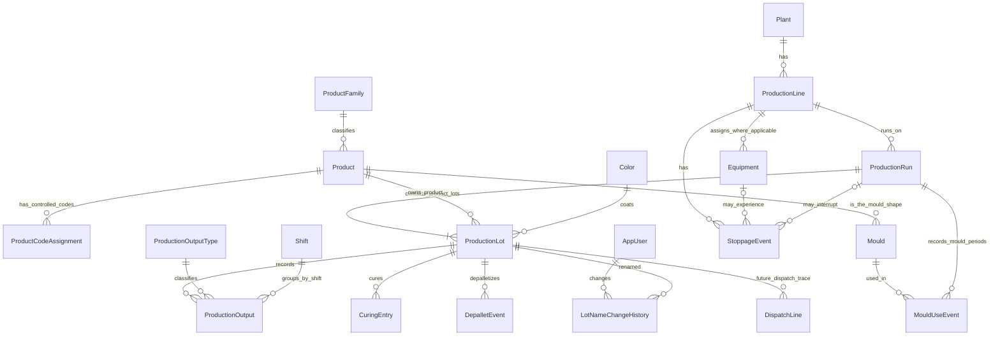

# OmagMES Confirmed Manufacturing Business Rules

**Prepared:** 2026-11-04  
**Status:** Consolidated requirements and evidence for plant-owner review. This is not executable schema or implementation approval.  
**Scope:** OmagMES manufacturing rules and logical model only. Historical Excel files remain unchanged.

## 1. Evidence labels

- **CONFIRMED** — directly specified by the plant owner in the requirements for this revision. These govern future OmagMES behavior.
- **OBSERVED** — supported by a specific record or scan in the Jan–Oct 2026 workbook analysis. Historical observations do not override confirmed future rules.
- **PROPOSED** — a logical-design recommendation requiring review before implementation.
- **UNRESOLVED** — not established by owner instruction or sufficient evidence; do not assume.

The mandatory ID-first standard was verified at [skill/DATABASE_ID_FIRST_DESIGN_SKILL.md](../skill/DATABASE_ID_FIRST_DESIGN_SKILL.md). Its required `id bigint IDENTITY(1,1)` primary key and `Rectime datetime NOT NULL DEFAULT (GETDATE())` apply to every eventual table. Foreign keys use authoritative IDs. This standard governs proposed logical design; it does not authorize implementation.

## 2. Confirmed plant and product rules

### CONFIRMED — physical line and product family

1. OMAG has **one physical ProductionLine** shared by Block and Fence products.
2. `ProductionLine` and `ProductFamily` are distinct concepts. Block and Fence are product families, not separate physical lines.
3. Equipment is associated with its actual physical line where applicable. OEE and downtime refer to the real line and/or real equipment, not fictitious family-based lines.
4. Product and Mould are tracked independently. Product-to-mould compatibility must not be inferred from code patterns.

### CONFIRMED — Product identity and Product Codes

1. Each authoritative Product Master record has its own immutable internal `Product.id`.
2. A Product Code is validated against the authoritative Product Master. Similar-looking codes are not automatically merged.
3. A Product Code change is controlled separately from Product identity. A code spelling change does not itself authorize a Product merge or identity change.
4. No inference is allowed that a suffix means color, a typing error, or an alias.
5. Each Production Lot belongs to exactly one Product.
6. For example, `zcc025010000011` and `zcc025010000011du` remain distinct exact code values until authoritative master-data review establishes their identities. Do not normalize case, strip suffixes, or merge them automatically.

### CONFIRMED — Color and Mould assignment

1. Product identifies the physical product shape; Color identifies an independent coating variation and is not embedded into Product identity by assumption.
2. A change of Product or Color creates a new Production Lot. A Color change alone does not require a new Product or a new Product-assignment Run; the Lot remains linked to the same Product while its Color changes.
3. Each physical Mould belongs to exactly one Product. Multiple Moulds may belong to the same Product. Do not create a many-to-many Mould/Product capability table.
4. Color is not a Mould attribute, capability, or eligibility dimension. A Mould's Product must match the Product of the Lot on which it is used.
5. A Mould change alone does not create a new Production Run or Lot; record it as a new Mould-use interval.

### CONFIRMED — Product production standards

1. Standard production settings belong to Product, not Mould. A Product may have several physical Moulds; each Mould has its own running number/MouldID and belongs to exactly one Product. Only one Mould is installed at a time; no many-to-many Product/Mould relationship is allowed.
2. Each Product requires both a positive integer `StandardPiecesPerDrop` (Pieces/Drop) and a positive decimal `StandardCycleTimeSec` (seconds/press Drop). These are independent dimensions; do not infer one from the other or assume identical values across Products.
3. MouldID identifies the physical tool and supports usage, reconditioning, and Current/Lifetime Age in Press Drops.
4. One press stroke is one Drop. Drops are not Pieces.
5. Historical `Std Data` values are evidence for owner review, not approved standards or an authority for backfilling Product Master data. The source labels `Std Data!BC` Cycle Time / Second; the owner-confirmed future basis is seconds per press Drop, but the historical source basis and approval/effective date still need verification. `Std Data!BA` has conflicting stacked labels and is not certified as Pieces/Drop.

### CONFIRMED — Wet production and OEE boundary

1. OMAG Press and Wet Line form one coupled production unit with one Wet Run Log and one Wet OEE.
2. Dry Line/Depallet is independent. Dry-line downtime is excluded from Wet OEE.
3. Intended Wet Performance is `ActualDrops × StandardCycleTimeSec / OperatingSeconds`. Wet Quality is `IPCameraWetGoodPieces / (ActualDrops × StandardPiecesPerDrop)`. Availability comes from the Wet Run Log, and OEE is Availability × Performance × Quality. Align Drops, camera counts, standard snapshot, and time to the same Product/Run window; the detailed treatment of mixed Product windows and data exceptions remains subject to owner approval.
4. Wet Good Pieces are counted by IP Camera records where `line='wet'`; do not substitute Press Drops or HMI Wet Rejects for camera good pieces. HMI Wet Reject records classify reasons and may not account for all calculated losses.
5. The legacy Excel OEE formula is historical evidence only. It does not override this confirmed Wet OEE model.

### PROPOSED — standard history and production snapshots

1. Keep Product-owned standard revisions with explicit effective periods and approval/source audit. An approved revision contains both positive standard values; prevent overlapping approved periods for one Product.
2. Freeze the selected standard revision and both numeric values on the relevant Production Run/Lot context. Later master changes must never recalculate completed historical OEE from a mutable current standard.
3. The owner must decide how a standard effective-date change during an open Run/Lot is applied. Do not silently switch the snapshot or create a new Run/Lot solely for a standards change.

### CONFIRMED — Press counter and Mould age

1. Kepware DataLogger provides Press counter observations at approximately five-minute intervals. Use one shared accumulator for the Press counter; do not build a per-stroke transaction stream.
2. The raw PLC counter may decrease/reset at times other than 07:00. Detect observed decreases/restarts, never apply a negative delta, and use the new reading as a baseline. Do not assume a fixed reset time.
3. Process observations in timestamp order and make reprocessing idempotent. Preserve gaps, invalid-quality observations, reset ambiguity, and unbracketed Mould changes as explicit uncertainty; do not invent, interpolate, or silently allocate unknown strokes.
4. Accumulated Press strokes are not finished-product quantities and must not be used as ProductionOutput, Curing quantity, reject quantity, or OEE counts.
5. Current Mould Age resets only after approved Return from Recondition. Lifetime Age never resets. PLC counter resets do not reset either Mould-age definition.

### CONFIRMED — Production Run and Lot boundaries

1. A Production Run represents a continuous assignment to one Product; temporary interruption can occur within the same Run.
2. A Product change always starts a new Production Run **and** creates a new internal Production Lot ID.
3. Returning to a Product after producing a different Product starts another new Run and another new Lot ID, even if the Product and desired LotName match a prior run.
4. Stopping for a pause, breakdown, repair, or other interruption and resuming the same Product does not automatically create a Run or Lot.
5. A shift change, calendar-date change, or mould change alone does not automatically create a Run or Lot.
6. Every Lot remains associated with its original Product and production period. Preserve Run start/end timestamps and relevant activity or interruption records.
7. Do not equate one report row, shift, or day with one Run.

### CONFIRMED — immutable Lot identity and editable LotName

1. `ProductionLot.id` is the internally generated, authoritative and immutable Lot identity. IDs are never edited or reused.
2. `ProductionLot.LotName` is an authorized-user-editable business/display name. Different Lot IDs may have exactly the same LotName; duplicate names are explicitly allowed.
3. LotName is neither a primary key nor a foreign key. It is never sufficient by itself to identify a Lot in APIs, imports, queries, or transactions. No `UNIQUE(LotName)` constraint is allowed.
4. Renaming a Lot never changes its `id`, Product association, or downstream relationships.
5. Maintain append-only LotName change history with old name, new name, user ID, timestamp, and reason.
6. User interfaces may search by LotName, but must show enough disambiguating information (at minimum Lot.id, LotName, Product Code and Product Name; production start or Run/status where useful). Selection must resolve to one Lot.id; never silently choose the first name match.

### CONFIRMED — lifecycle traceability

1. The original internal Lot ID is retained across **Production → Curing → Depallet → Sale/Dispatch**.
2. Curing and Depallet do not create replacement Production Lot IDs. Their records reference the original Lot ID.
3. Multiple Curing and multiple Depallet records may refer to a Lot when the process requires them. Multiple depallet operations per Lot must be supported.
4. Future Sale/Dispatch transactions preserve the original Lot ID; multiple dispatch transactions per Lot must be supported.
5. LotName changes cannot break or rewrite lifecycle relationships.
6. Do not invent transaction quantities, transfer timestamps, or event details absent from the source evidence. These are future-system requirements, not claims about historical records.

## 3. Observed workbook evidence (historical, not overriding)

**OBSERVED:** The Jan–Oct analysis scanned populated production rows in the ten monthly production workbooks using a consistent Product Code + Lot predicate. It found repeated raw Lot strings across shift sheets and months, multiple exact codes under some Lot strings, and some daily-sheet dates inconsistent with their workbook folders. These are investigation flags, not automatic corrections or internal MES Lot IDs. Detailed counts and source references are in [OmagMES_Manufacturing_Process_Analysis_Jan_Oct_2026.md](OmagMES_Manufacturing_Process_Analysis_Jan_Oct_2026.md).

**OBSERVED:** October `PLAN-ACTUAL` rows 5–6 record Lot `01161` with `zcc025010000011` and `zcc025010000011du`; rows 32–33 show another two-code pattern for `02162`. October daily sheet 2 row 67, sheet 3 row 58, and sheet 6 row 64 show `C300926201B` with code/date differences. These do not establish which historical entry is correct or whether the codes represent one or multiple Products.

**OBSERVED:** The quality workbook's `Std Data` is not verified as the authoritative Product Master. June production sheets and a curing log share some Lot strings, but date/quantity reconciliation is incomplete. Daily dry-output fields overlap production Lot strings, but the reviewed report is not verified as an independent Depallet transaction ledger. No historical workbook evidence authorizes using a LotName to merge rows into one future internal Lot.

**OBSERVED counter qualification:** The separate bounded `OMAG.dbo.PRESS` analysis found roughly 25–48 second sample spacing during selected dense periods, longer gaps, and valid-quality decreases at varying times. This does not establish that `PRESS` is the same feed as the approximately five-minute Kepware DataLogger observations. The source/table alignment, timestamps, quality meaning, and logger cadence require confirmation; the bounded historical sample does not override the confirmed accumulator rules above.

**OBSERVED Product/OEE qualification:** The Jan–Oct Excel formula and standards investigation is documented in [OmagMES_Product_Standards_and_Wet_OEE_Excel_Analysis.md](OmagMES_Product_Standards_and_Wet_OEE_Excel_Analysis.md). `Std Data!BC2` is `Cycle Time`, `BC3` is `Second`, and the cycle-time sheets look up column BC as `STD`; this supports a Product-specific seconds field but does not independently prove the historical value is per press Drop or approved. `Std Data!BA2` labels `ก้อน/Drop` while `BA3` labels `pcs./pallet`; values such as `BA8=45` cannot be certified as Pieces/Drop from that conflicting header stack. Across the ten snapshots, 800 of 855 exact CSV Product Codes appear at least once; 110 of 118 `ObservedInProduction=YES` codes appear. Values and some month snapshots differ. The legacy `OEE_Monitor` Performance is cycle-time/time based, aggregates separate Block/Fence sheets, and does not explicitly use actual Press Drops or IP Camera good pieces. It is not the confirmed Wet Performance definition.

## 4. Proposed logical interpretation

**PROPOSED:** Keep ProductionRun and ProductionLot as separate tables. One Run represents a continuous line assignment to one Product and may contain multiple sequential Lots when Color changes:

- ProductionRun records the line assignment, one Product, start/end period, and continuity through interruptions.
- ProductionLot is the immutable production/lifecycle identity, references exactly one Product and one Color variation, and has the editable LotName. Its Product must match the Product on its Run.
- A Product change closes the current Run and creates a new Run and Lot. A Color change creates a new Lot within the existing Run. ProductionRun may therefore have multiple sequential Lots; each Lot belongs to one Run. Store Product identity once where practical or enforce equality if the chosen SQL Server FK design repeats ProductID; never allow Run/Lot Product mismatch.
- Shift/date production output rows refer to Lot.id and carry their actual shift/work-date grain. They do not create Run/Lot boundaries. Stoppage events can optionally reference the active Run to document interruption without creating a replacement Lot.
- CuringEntry, DepalletEvent, and future DispatchLine each reference ProductionLot.id directly. Display names may be shown or snapshotted for human review but are never relationship keys.

**PROPOSED:** ProductCode assignments are stored separately and changed through reviewed, auditable master-data operations. Exact code matching must use an explicitly case-sensitive comparison policy; code values are not automatically trimmed, uppercased, or suffix-normalized. A changed code can be assigned to an existing Product only after authoritative owner approval.

**PROPOSED:** Historical imports first preserve source file, sheet, row/cell reference, and original raw values. They stage unmatched or ambiguous rows as exceptions. Reviewers explicitly map each reconciled source Lot occurrence to an internal ProductionLot.id and a validated Product.id. Repeated LotName strings never trigger merges. Decisions, reviewer, timestamp, reason, and source row remain auditable; unapproved rows remain unresolved and are not posted as authoritative transactions.

## 5. ER relationship summary

This describes the proposed model, not an implemented schema. Optional equipment/run link behavior, event grain, and future dispatch header structure remain subject to review. Every relationship uses IDs, not Product Code or LotName.

## 6. Duplicate LotName safety

Lot 501 and Lot 503 can both be named `LOT-A01` and belong to Product A while remaining different immutable Lots because a Product B run occurred between them. The system distinguishes the two by `ProductionLot.id`; their Run IDs, production periods, outputs and downstream records remain separately attached. An operator can intentionally reuse a display name, but a Curing/Depallet/Dispatch selection must display Lot ID plus Product and production context and submit only the selected ID. Rename audit history changes the display label, never the ID or foreign keys.

Likewise, pausing Product A for repair and resuming it without switching Product or Color continues the existing Run and Lot. The interruption is recorded against that Run when applicable; neither date/shift boundary nor interruption manufactures a new Lot. A Color change does create a new Lot, even while the Product Run continues.

## 7. Unresolved — owner decisions required

1. Authoritative Product Master source, code casing/collation, effective-date policy, and whether an owner-approved code change can preserve Product identity versus representing a distinct Product.
2. Approved ProductFamily and Plant/line/equipment master identifiers; equipment that belongs to the single line versus plant-wide/shared assets; effective assignment history when equipment moves.
3. Run start/end capture semantics, status/close process, interruption vocabulary, and handling of correction/reopen operations.
4. Official shifts, start/end times, overnight WorkDate attribution, and whether a Run may span multiple reports and shifts (rules say boundaries alone do not end it; reporting treatment remains to define).
5. Production output meaning and grain, including planned/gross/good/waste/reject/rework quantities and units; how shift summaries and source corrections are represented.
6. Curing record grain, room master, loading/unloading semantics, partial transfer behavior, and whether quantities are captured. Historical curing examples do not reconcile quantity.
7. Depallet event fields, event time, product quantity units, status/reversal, and whether/when reject details are required. The dry-output workbook is not verified as an event ledger.
8. Product Master authority; resolution of `Std Data!BA2`/`BA3` unit conflict; approval and per-Drop basis for historical `Std Data!BC`; effective dates, precision, approval and correction policy for both Product standards.
9. Run/Lot standard snapshot structure and the rule for an effective standard change during an open Run/Lot.
10. Wet Run Log planned/operating-time definitions; same-window alignment of standard, Drops and IP Camera counts; mixed-Product aggregation, missing/zero-denominator eligibility, counter-boundary uncertainty and above-100% review policy. Actual-drop source and shared-accumulator relationship; coupled Press/Wet Line stoppage policy and explicit Dry Line/Depallet exclusion.
11. Authoritative Mould register, one-Product assignment control, use/change event capture, Mould-drop workbook assignment/ACT meaning and unit, Mould-age cycle model, and recondition approval/reset workflow.
12. Downtime classification, planned/unplanned mapping, minor-stop threshold, and event overlap/attribution. Existing workbook formulas are not approved KPI rules.
13. Quality sampling, specification revision, reject/disposition linkage, user identity/authentication source and retention requirements.
14. Dispatch document/header grain, customer/order identifiers and quantity/reversal rules for the future module.
15. Historical import source file versioning, exact row-level locator, mapping approval roles, correction/reversal process, and how ambiguous date/Product Code conflicts are escalated.

No item above may be silently inferred from Lot strings, Product Code patterns, workbook directory names, or cached formulas.
