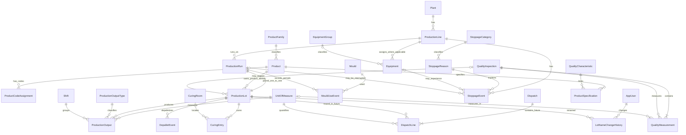

# OmagMES Logical Database Design — Consolidated Manufacturing Rules

**Prepared:** 2026-11-03  
**Status:** Logical design for plant-owner review only. Not executable DDL; no schema or database changes are authorized.  
**Target:** Future SQL Server implementation in an isolated `omagmes` namespace, subject to a fresh authorized pre-deployment assessment.  
**Scope:** Manufacturing identity, production, curing, depallet, equipment/mould, downtime, quality foundations, and future dispatch traceability. Unrelated legacy tables are excluded.

## 1. Design basis and labels

Use [OmagMES_Confirmed_Business_Rules.md](OmagMES_Confirmed_Business_Rules.md) as the consolidated rule source and [OmagMES_Manufacturing_Process_Analysis_Jan_Oct_2026.md](OmagMES_Manufacturing_Process_Analysis_Jan_Oct_2026.md) for historical evidence and qualifications.

- **CONFIRMED** requirements are directly specified by the plant owner and govern future behavior.
- **OBSERVED** workbook patterns are historical evidence only. They are not automatically correct or authoritative.
- **PROPOSED** entity/constraint choices below require design review but must honor confirmed rules.
- **UNRESOLVED** items are not implemented as hidden assumptions; obtain decisions before executable DDL.

The applicable standard was verified at [skill/DATABASE_ID_FIRST_DESIGN_SKILL.md](../skill/DATABASE_ID_FIRST_DESIGN_SKILL.md) (`D:\AI\OmagMES\skill\DATABASE_ID_FIRST_DESIGN_SKILL.md`). For **every** eventual table, including all masters, history, events, and staging tables, include:

- `id bigint IDENTITY(1,1) NOT NULL PRIMARY KEY`
- `Rectime datetime NOT NULL DEFAULT (GETDATE())`, record creation time, supplied by the database
- ID-based foreign keys to authoritative rows where available

No name, Product Code, LotName, external reference, or numeric ID's implied meaning substitutes for an ID. The types below are logical field suggestions only; SQL syntax and deployment artifacts are deliberately omitted.

## 2. Core design decisions

### 2.1 One physical ProductionLine; separate ProductFamily

`ProductionLine` represents the actual physical line at a Plant. `ProductFamily` represents a product classification, including Block/Fence. Product references ProductFamily; ProductionRun and line-associated Equipment reference ProductionLine. Never create Block and Fence physical lines. OEE/downtime attach to the actual line/equipment.

### 2.2 Product and exact Product Code

`Product.id` is immutable product identity. `ProductCodeAssignment` separately holds the authoritative code value and effective period. Exact Product Code lookup must follow a reviewed case-sensitive comparison/collation policy; do not uppercase, trim, suffix-strip or merge. Each code assignment is master-data controlled and audited. An observed new code does not become an alias or the same Product without authoritative approval.

### 2.3 Run and Lot are separate, initially one-to-one

**PROPOSED initial relationship:** one ProductionRun pairs with exactly one ProductionLot. Create both in a single controlled operation. ProductionRun stores physical-line assignment and continuous assignment timestamps. ProductionLot stores the immutable generated identity, one ProductID and editable LotName. This separation is justified because the Run describes the line's continuous production assignment/interruption lifecycle, while the Lot is the durable product identity referenced through curing, depallet and future dispatch. Run does not copy ProductID; Product is resolved through its one-to-one Lot. Lot does not copy Run timestamps or line identity.

A different product always means a new Run and new Lot. A pause/repair/resumption on the same Product, shift change, date change, or mould change does not automatically end either. A mould change is represented separately as a MouldUseEvent within the existing Run. Application transaction/validation must ensure each Run is paired with one Lot at creation and prevent a Run/Lot Product mismatch by storing ProductID only on the Lot.

### 2.4 Lot identity, LotName and UI

`ProductionLot.id` is database-generated, opaque and never edited/reused. `LotName` is editable display/business text; duplicates are allowed and there is no unique constraint. It is not a PK/FK and is never the sole request/import/query key. Every dependent lifecycle row references `ProductionLot.id`.

Lot selectors show Lot.id, LotName, exact Product Code, Product Name and production start/status context. Search can match name, but the user must select one row and the submitted value is the selected Lot.id. Multiple matches require a deliberate selection; no silent first result. LotName changes append old/new name, user ID, timestamp and reason to the audit table; updates leave all IDs/relationships unchanged.

### 2.5 Lifecycle and history

Production output, CuringEntry, DepalletEvent and future DispatchLine reference the same original Lot.id. A Lot can have multiple output, curing, depallet and dispatch records as process requires. Do not copy LotName into a FK or generate another Lot during curing/depal.

Historical import is staged and row-addressable. Preserve source file/version, sheet and row/cell locator, raw LotName, raw Product Code, raw date, and any source event reference. Only explicit, reviewed mappings assign source records to immutable internal Product/Lot IDs. Ambiguous code/date/Lot conflicts remain exceptions; a repeated label never triggers an automatic merge. Source corrections remain traceable.

## 3. ER relationship overview

All edges are ID foreign-key relationships. Product name/code and LotName are display/business fields only. Some optionality and event grain are proposed pending owner review.

## 4. Common rules applying to every proposed table

| Concern | Rule |
|---|---|
| Primary key | `id bigint IDENTITY(1,1) NOT NULL PRIMARY KEY`; immutable opaque identity. |
| Creation time | `Rectime datetime NOT NULL DEFAULT (GETDATE())`; do not overload it as an event time or update timestamp. |
| Foreign keys | Store authoritative IDs, never mutable names or labels. Do not duplicate ProductID in both Run and Lot. |
| Mutable master data | Prefer deactivation/effective dates and append-only change records where history matters; do not delete referenced rows. |
| Event time | Store a distinct event timestamp/date when the event requires it; do not infer event time from Rectime or a workbook folder. |
| Audit actor | Use an OmagMES user ID FK when an authenticated actor is in scope. Never store a user's display name as relational identity. |
| Exact codes | Preserve original code text. Configure exact comparison deliberately; don't assume database default collation is case-sensitive. |
| Constraints | Add only stated, reviewable constraints. No LotName uniqueness. No workbook-driven merging or inferred Product/Mould compatibility. |

## 5. Proposed core and operational table catalog

In every row below, the PK includes the common `id` and `Rectime` columns above. “Audit” notes additional audit/history needs beyond Rectime. Cardinalities are logical expectations; unusual optional relationships are marked.

### 5.1 Reference and product identity

| Table / purpose | Required FKs and important columns | Cardinality, validation and uniqueness | Audit / rationale / evidence status |
|---|---|---|---|
| `Plant` — plant/factory identity. | None. `PlantCode`, `PlantName`, active/effective status. | One Plant has many ProductionLines. Unique authoritative PlantCode; validate active status. | Master changes audited/deactivated. **PROPOSED**; workbook factory labels are observed, not authoritative. |
| `ProductionLine` — actual physical line. | `PlantID`; `LineCode`, `LineName`, active status. | Plant 1:M line conceptually; for the current OMAG scope enforce one physical line for its Plant (e.g. unique `PlantID`), not one line per family. Unique `(PlantID, LineCode)` also documents the business code. Current operation is one shared OMAG line, not Block/Fence lines. | Changes audited; assignments to equipment reviewed. **CONFIRMED** one physical line shared by both families. Supporting other plants/multiple lines later requires explicit scope review. |
| `ProductFamily` — product grouping. | `FamilyCode`, `FamilyName`, active status. | Family 1:M Product; unique authoritative code. Values Block/Fence are separate from physical ProductionLine. | Master-data audit. **CONFIRMED** concept; codes/authoritative master remain to verify. |
| `Product` — immutable product master identity. | `ProductFamilyID`; display name, active status. | Family 1:M Product. Product has own generated id; no Product Code as PK. | Audit master-data edits; preserve effective identity. **CONFIRMED** immutable Product.id. |
| `ProductCodeAssignment` — controlled exact code values for Products. | `ProductID`; `ProductCode`, `ValidFrom`, nullable `ValidTo`, primary/current indicator only if approved, optional `CreatedByUserID` FK when identity is available, change reason. | Product 1:M historical assignments. Exact code globally identifies at most one assignment under approved exact comparison; prohibit overlapping/current ambiguity. Never auto-assign a similar spelling to an existing Product. | Append-only assignment changes or audited retirement; preserve old values. **CONFIRMED** codes controlled separately; effective dating/alias rules **UNRESOLVED**. |
| `Shift` — shift identity used for output/event reporting. | `ShiftCode`, `ShiftName`, active status. | Unique authoritative ShiftCode. Do not use shift boundaries to create Runs/Lots. | Audit schedule changes. **CONFIRMED** shift boundary is not a Lot boundary; actual schedule **UNRESOLVED**. |
| `UnitOfMeasure` — explicit units for quantity/measurement values. | `UnitCode`, `UnitName`, optional `DimensionCode`, active status. | Unique approved UnitCode. Do not sum/convert unlike units without an approved conversion definition. | Audit code/definition changes; unit abbreviations in workbooks are observed, not authoritative. **PROPOSED**. |
| `ProductionOutputType` — configurable output quantity classification. | `OutputTypeCode`, `OutputTypeName`, active status. | Unique authoritative code; `ProductionOutput` references its ID. Do not seed gross/good/waste/reject values until their meanings are approved. | Master changes audited; populate only from approved definitions. **PROPOSED** because output categories are unresolved. |
| `EquipmentGroup` — optional classification drawn from owner-approved vocabulary. | `GroupCode`, `GroupName`, active status. | Group 1:M Equipment; unique GroupCode if retained. | Audit classifications; don't encode OEE scope in labels. **OBSERVED** workbook group vocabulary; master status **UNRESOLVED**. |
| `Equipment` — independently identified physical equipment. | Optional `ProductionLineID` where actually line-associated; optional `EquipmentGroupID`; `EquipmentCode`, `EquipmentName`, status. | ProductionLine 1:M assigned Equipment; equipment may be unassigned/shared until owner assigns. Unique code globally or per line only after code scope is approved. | Audit equipment identity/assignment; use effective assignment history if movement matters. **CONFIRMED** associate actual equipment where applicable; inventory/code scope **UNRESOLVED**. |
| `Mould` — independent tooling identity. | `MouldCode`, `MouldName`, active status; optional type/serial per owner. | Mould 1:M MouldUseEvent; unique code only in authoritative mould registry. No code-pattern compatibility. | Audit identity, retirement and replacement. **CONFIRMED** independent tracking; workbook register is not yet authoritative. |
| `ProductMouldCompatibility` — optional explicit approved applicability mapping. | `ProductID`, `MouldID`, effective dates, approval/reference. | Many-to-many only if owners require a compatibility gate; unique effective mapping/no overlapping conflicting periods. | Effective-dated approval history. **PROPOSED/OPTIONAL**; do not seed/infer from code or workbook labels. |

### 5.2 Production Run, Lot, output, mould and stoppage

| Table / purpose | Required FKs and important columns | Cardinality, validation and uniqueness | Audit / rationale / evidence status |
|---|---|---|---|
| `ProductionRun` — continuous assignment to a Product on the real line. | `ProductionLineID`; `StartAt`, nullable `EndAt`, status/closure fields only after status policy is approved. No `ProductID`. | One Run pairs with exactly one Lot in initial model. Validate end >= start and no overlapping active assignments on the same line if plant policy requires. Product switch closes/ends current assignment and creates a new Run/Lot in one transaction. | Preserve lifecycle and controlled correction/reopen audit. **CONFIRMED** boundary semantics; exact start/close capture **UNRESOLVED**. |
| `ProductionLot` — immutable production and lifecycle identity. | `ProductionRunID` unique FK (makes each Run pair to at most one Lot); `ProductID`; `LotName`; creation/production period context only if not duplicated from Run. | Product 1:M Lots; Run 1:1 Lot. Generated `id` never changed/reused. **LotName explicitly non-unique** and not FK/key. Create with Run atomically; enforce Product identity only here to avoid mismatch. | Rename only through controlled update plus `LotNameChangeHistory`; preserve Product and lifecycle links. **CONFIRMED**. |
| `ProductionOutput` — production quantity facts or approved shift summaries. | `ProductionLotID`, `ShiftID`, `ProductionOutputTypeID`, `WorkDate`, quantity, `UnitOfMeasureID`, optional event time/source. | Lot 1:M output facts. Group by Lot/Shift/WorkDate for shift summaries; shift/date do not define Run/Lot. Quantity type and unit must be explicit; no mixing units. Avoid a uniqueness rule until record grain/corrections are agreed. | Corrections/reversals retain source/actor history. **CONFIRMED** lot/shift/date rules; output categories/grain **UNRESOLVED**. |
| `MouldUseEvent` — explicit mould use/change interval within production. | `ProductionRunID`, `MouldID`, start/end, optional verified operator/source. | Run 1:M mould-use periods; mould can be used in many periods. Validate interval and overlap policy. A mould change within same Product Run never automatically creates a new Lot. | Corrected intervals audited. **CONFIRMED** mould independence/boundary rule; event capture source **UNRESOLVED**. |
| `StoppageCategory` — configurable classification for reason records. | `CategoryCode`, `CategoryName`, active/effective status. | Category 1:M StoppageReason; unique authoritative code. Planned/unplanned/OEE treatment must be explicit approved configuration, not inferred from code. | Do not seed mappings until maintenance/OEE owners approve. **PROPOSED**; categories remain **UNRESOLVED**. |
| `StoppageReason` — owner-configurable event reason master. | `StoppageCategoryID`, `ReasonCode`, name, effective status. | Category 1:M reasons; unique authoritative code. Planned/unplanned and applicability are explicit data, not code-range logic. | Effective-date/audit mapping. **OBSERVED** reason lists; category assignments **UNRESOLVED**. |
| `StoppageEvent` — interruption/downtime on actual line/equipment; optional Run linkage preserves context. | `ProductionLineID`, optional `EquipmentID`, optional `ProductionRunID`, optional `ShiftID`, `StoppageReasonID`, start/end, captured duration if needed. | Line 1:M events; optional equipment/run. Validate equipment belongs to line where applicable, end >= start, and duration/time-source policy. A stoppage/resumption on same Product remains the same Run/Lot. | Corrections and reason changes audited. **CONFIRMED** pauses don't force Lot split; workbook supports stoppage vocabulary only, not full Lot attribution. |

**Run/Lot one-to-one enforcement note:** The FK on `ProductionLot.ProductionRunID` is unique. The application creates Run and Lot in one transaction and does not expose a run-only record as an active product assignment. A Run without a Lot must not be used for production. A future alternative could merge the two tables only if owners accept losing their separate operational responsibilities; do not retain both without this explicit one-to-one role.

### 5.3 Lifecycle, Lot rename audit and user identity

| Table / purpose | Required FKs and important columns | Cardinality, validation and uniqueness | Audit / rationale / evidence status |
|---|---|---|---|
| `AppUser` — actor identity for audit. | Approved user/account key, display name, active status; external login identifier is not the PK. | One user may author many history/audit rows. Unique login/external key only if identity provider guarantees it. | Do not put credentials here. User source and lifecycle **UNRESOLVED**; needed for accountable rename history. |
| `LotNameChangeHistory` — append-only audit of a LotName change. | `ProductionLotID`, `OldLotName`, `NewLotName`, `ChangedByUserID`, `ChangedAt`, `Reason`. | Lot 1:M changes; reject no-op changes if policy says so. No uniqueness on either name. One history row per accepted change. | Append-only and tamper-controlled; `ChangedAt` is event time distinct from Rectime. **CONFIRMED** fields and audit obligation. |
| `CuringRoom` — optional room/curing location master if selection/configuration is needed. | `RoomCode`, name, active status. | One room has many CuringEntries; unique approved RoomCode. May be omitted if validated process needs only external location text, but do not use name as FK. | Master audit. Workbook has room labels; canonical room inventory **UNRESOLVED**. |
| `CuringEntry` — one curing record/cycle that preserves original Lot. | `ProductionLotID`, optional `CuringRoomID`, observed/recorded cycle fields (e.g. entered/closed/opened times only after event meaning is agreed), operator/source IDs as available. | Lot 1:M curing entries; no new Lot ID. Do not assume one entry equals one pallet/load or infer a quantity. Exact cycle grain and required fields are to be approved. | Preserve source reference and correction history. **CONFIRMED** Lot link/multiplicity; historical quantity transfer unresolved. |
| `DepalletEvent` — an individual depallet operation referencing original Lot. | `ProductionLotID`, event time, quantity/unit/status only as owner-defined, optional operator/source. | Lot 1:M events; support multiple operations. Do not generate replacement Lot IDs or infer transaction from summary rows. Reversal/duplicate policy remains open. | Event corrections/reversals auditable; source reference retained. **CONFIRMED** Lot link/multiplicity; actual workbook dry-output is not a verified event ledger. |
| `DepalletReject` — optional reject detail for an actual DepalletEvent. | `DepalletEventID`, reason ID, quantity/unit, disposition only if defined. | DepalletEvent 1:M reject details only if process requires. Ensure reject quantity does not exceed relevant output only if unit/grain and rule are approved. | Excluded from initial core pending actual requirement. Reject/return workflow **UNRESOLVED**; do not infer from inspection anomalies. |

### 5.4 Quality tables (proposed module; event traceability to Lot when established)

| Table / purpose | Required FKs and important columns | Cardinality, validation and uniqueness | Audit / rationale / evidence status |
|---|---|---|---|
| `QualityCharacteristic` — characteristic vocabulary. | Code/name, value type, default unit if relevant. | Unique approved code; numeric/categorical rules configured rather than hardcoded where owners can change them. | Master/effective-date audit. Workbook measurements include dimensions, weight, moisture and shade; authority/rules **UNRESOLVED**. |
| `ProductSpecification` — effective Product/characteristic limits. | `ProductID`, `QualityCharacteristicID`, optional unit ID, lower/upper/categorical limits, effective dates, approved revision. | Product 1:M specifications; prevent conflicting effective intervals for same product/characteristic after revision policy is defined. Validate limit order and units. | Preserve revision/approval history and which spec applied to inspection. **PROPOSED**; workbook standards not verified authoritative. |
| `QualityInspection` — inspection occasion/sample. | Optional `ProductionLotID` when actual association is known, `InspectedAt`, optional ShiftID, inspector user ID, source/sample reference. No duplicate ProductID if Lot is supplied. | Lot 1:M inspections when linked; inspection may remain unlinked only if capture process allows. Don't infer Lot from Product Code alone. | Preserve captured values/spec revision/source. Sampling, dispositions and trace scope **UNRESOLVED**. |
| `QualityMeasurement` — one measured characteristic result. | `QualityInspectionID`, `QualityCharacteristicID`, unit ID as relevant, numeric/text value, applicable `ProductSpecificationID` if resolved. | Inspection 1:M measurements. Enforce value type/unit/limit checks only under approved characteristic model. | Preserve original measurement and spec used; abnormal flag may be snapshot/result with explicit rule. Reject transaction remains separate. |

## 6. Future Sale/Dispatch and historical reconciliation

### 6.1 Future dispatch (not first-release implementation scope)

| Table / purpose | Required FKs and important columns | Cardinality, validation and uniqueness | Audit / rationale |
|---|---|---|---|
| `Dispatch` — outbound transaction header, if future workflow requires it. | Plant/customer/order/document IDs from approved masters, dispatch time/status/reference. | Header 1:M lines; unique document business reference only in its confirmed scope. | Full order/customer and reversal semantics unresolved. |
| `DispatchLine` — Lot-traced quantity leaving in one dispatch. | `DispatchID`, `ProductionLotID`, quantity/unit and any required status. | A Lot may occur in multiple lines and multiple Dispatches. Each line references original Lot.id. Do not store LotName as relationship; optional historical display snapshot is never a join key. | Corrections/reversals auditable. **CONFIRMED** future trace and multiple dispatches per Lot; other fields unresolved. |

### 6.2 Controlled historical source mapping (proposed, before any import)

| Table / purpose | Required FKs and important columns | Controls |
|---|---|---|
| `HistoricalImportBatch` — identifies a reviewed source/import attempt. | Source/file version/hash, captured time, import status, initiating user ID. | Unique batch/source version rule reviewed; source files remain read-only. |
| `HistoricalSourceRecord` — immutable row-addressable raw source. | `HistoricalImportBatchID`, workbook path/name, sheet, row/cell range, raw LotName, raw Product Code, raw date text/value, source event fields. | Preserve raw values exactly; one source locator within batch; no inferred corrected date/code. |
| `HistoricalLotReconciliation` — reviewer decision mapping one source occurrence. | `HistoricalSourceRecordID`, nullable `ProductionLotID` until resolved, validated ProductID/source code resolution as applicable, status, reviewer user ID, review time, reason/evidence. | No automatic mapping by LotName alone; ambiguous/conflicting rows remain exception status. Approved mapping references immutable internal ID and can never silently merge existing Lots. Maintain decision history. |

These staging/reconciliation entities are design recommendations, not approved import scope. The historical examples `01161`, `02162`, `C300926201B`, cross-month repetitions, and June production/curing date differences require explicit exception review. Preserve all original workbook data and source coordinates; do not correct or merge source workbooks.

## 7. Relationship cardinality and integrity summary

- Plant 1:M ProductionLine.
- ProductionLine 1:M ProductionRun; Equipment has an optional actual-line association.
- ProductFamily 1:M Product; Product 1:M ProductCodeAssignment history.
- ProductionRun 1:1 ProductionLot in initial model; Product 1:M ProductionLot. Only Lot stores ProductID, preventing duplicate ProductID disagreement.
- ProductionLot 1:M ProductionOutput, CuringEntry, DepalletEvent, LotNameChangeHistory, QualityInspection (when traceable), Historical reconciliation mappings, and future DispatchLine.
- ProductionRun 1:M MouldUseEvent and optional linked StoppageEvent. Mould changes do not split Run/Lot.
- ProductionLine 1:M StoppageEvent, optionally linked to actual equipment and active Run.
- Dispatch 1:M DispatchLine; many DispatchLines over time can reference one Lot.

All PK/FK references use `id bigint`. ProductCode and LotName remain business text and never appear as relational FKs. `Rectime` exists on every table; business event times are separate columns.

## 8. Uniqueness, validation and audit policy

### Must hold from confirmed rules

- Generated surrogate IDs are immutable and never reused.
- Exactly one Product per ProductionLot.
- One Run/one Lot pairing in the initial logical design; pair created atomically.
- Product switch creates a new Run and Lot. Pause, date/shift boundary, and mould change alone do not.
- LotName is mutable and duplicate by design. No unique key/index and no API FK based on it.
- Every lifecycle record references the original `ProductionLot.id`; multiple curing/depal/dispatch rows per Lot are permitted.
- Product Code checks resolve against authoritative Product Master; never infer code equivalence.

### Constraints requiring design/owner approval

- ProductCodeAssignment exact uniqueness/collation, one-current-code rule, date overlap, code reuse and alias handling.
- Run active-overlap constraints and allowed close/reopen semantics.
- ProductionOutput grain, corrections, type/category and quantity/unit validation.
- Curing/depal event required time/quantity fields and reversal rules.
- Equipment-code uniqueness scope and equipment-line assignment history.
- Mould compatibility/effective dates and event overlap.
- Shift schedule, overnight reporting date and OEE/downtime overlap classification.
- Quality measurement type/specification enforcement and Lot linkage requirements.
- Dispatch document uniqueness, partial shipment/return, and transaction reversal.

### Audit

- `Rectime` is creation time only and cannot substitute for `ChangedAt`, event time, or an update audit.
- LotName history is append-only with old/new name, user ID, timestamp, and reason.
- Product code assignments and master-data corrections retain prior values/effective periods and actor/reason where approved.
- Operational event corrections must preserve source/original and correction actor/time; do not overwrite historical source evidence invisibly.
- User identity uses an authoritative user ID if the authentication/user model is approved; no password/credential design is included.

## 9. Explicitly excluded / unresolved module decisions

No first-release table set is authorized yet. `DepalletReject` remains optional. Inventory receipts, Silo balances, material movements/returns, logger integrations, material standards, yield/OEE persistence, detailed route/work centers, pallet issues, recycled concrete, and mould drop-life accounting need owner-confirmed transaction grain and definitions before design. Quality tables above are a candidate module, not proof that the workbook's formula/spec records are current or authoritative.

The workbook analysis observed Lot recurrence, code/date conflicts, curing entries without reconcilable quantities, and dry-output summary overlap. It did **not** establish correct historical dates, authoritative Product Code identity, individual Depallet transactions, or an approved OEE/yield/reject calculation. Keep these as `OBSERVED`/`UNRESOLVED`, not schema defaults.

## 10. Plant-owner review checklist before implementation

1. Approve the single physical line and ProductFamily separation; identify authoritative plant/line/equipment masters.
2. Identify authoritative Product Master and code comparison/effective-date/identity-change policy.
3. Approve initial one-to-one Run/Lot model, Run start/end/interruption capture, and correction workflow.
4. Approve LotName permissions, duplicate-name UI disambiguators, audit actor source and rename reason requirements.
5. Define shift schedule, WorkDate, output grain, quantity classes, units and corrections.
6. Define curing and depallet event semantics without backfilling unverified historical transfer quantities/times.
7. Define mould and equipment assignment/compatibility evidence; confirm mould changes remain within existing Lot when Product is unchanged.
8. Confirm downtime/OEE, quality/reject and dispatch module scopes and authoritative rules.
9. Approve historical import locators, raw evidence retention, exception queue, reviewer authority and explicit mapping/reversal process.
10. Only after approval, prepare separate reviewed SQL Server DDL, rollback and tests; recheck the authorized OmagMES namespace and authoritative IDs then. No unrelated legacy redesign or database implementation is included here.
