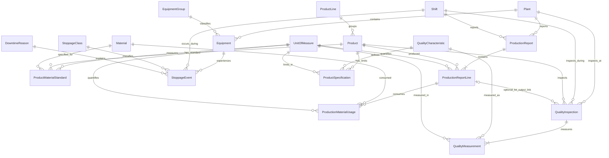

# OmagMES Proposed Database Design

**Prepared:** 2026-11-02  
**Status:** Logical design for review only. Not executable DDL. No database changes have been made.  
**Target:** SQL Server database `OMAG`, isolated in a proposed `omagmes` schema.  
**Scope:** Independent OmagMES model based on workbook discovery; unrelated system tables are explicitly excluded.

## 1. Design principles and scope

This is a reviewable proposal, not a finalized process model. Workbook observations are labeled **Observed**; proposed structures or policy are labeled **Proposed**; unresolved semantics are **Confirm**. The design must not be used to implement migrations until owners approve the business decisions in section 9.

- Namespace all proposed objects under `omagmes`; do not modify or depend on unrelated schemas.
- Include the required base columns on **every** proposed table:
  - `id bigint IDENTITY(1,1) NOT NULL PRIMARY KEY`
  - `Rectime datetime NOT NULL DEFAULT (GETDATE())`
- Use surrogate `id` values for PK/FK relationships. Business codes, lot codes, source identifiers, labels, and snapshots are not relational identity.
- Business codes are separate, unique, and treated as strings; do not infer meaning from code ranges or numeric IDs.
- Configurable classes and mappings reside in database reference/configuration data. The application must resolve authoritative IDs and revalidate them on save.
- Do not persist workbook-derived KPI interpretations until owners approve formulas and their inputs.

### Evidence boundary

The discovery report confirms report fields for plant/factory, shifts, product/material codes, date/shift/lot, production quantities, material usage, equipment/reason codes, stoppage durations, and quality readings. It does **not** establish exact business definitions, authoritative master ownership, workflow, full route, common record ID, or approved formula semantics. See [`OmagMES_Initial_Discovery.md`](OmagMES_Initial_Discovery.md).

## 2. Logical relationship overview

Relationship multiplicities and the optional production-line link are proposals; confirm the actual event grain and inspection workflow before implementation.

## 3. Shared physical conventions

- SQL Server types below are proposals. Lengths and precision must be checked against approved code lists, values, units, and expected retention.
- Every table below receives the required `id` and `Rectime` columns, even when a natural business key or event-time field exists.
- `Rectime` is creation time only; event timestamps are distinct business fields.
- All named FKs point to the target table's `id bigint`.
- `IsActive` is a proposal for reference masters. Prefer deactivation/effective dates over deleting referenced master rows.
- Apply `NOT NULL`, checks, and unique constraints only where stated and confirmed. No SQL statements are supplied in this document.

## 4. Proposed reference and configuration tables

### `omagmes.Plant`

| Column | Proposed type | Rules / meaning |
|---|---|---|
| `PlantCode` | `varchar(30)` | Required, unique business code. **Confirm** approved code and whether workbook plant/factory values are current. |
| `PlantName` | `nvarchar(200)` | Required display name. |
| `IsActive` | `bit` | Required; proposed default active. |

### `omagmes.Shift`

| Column | Proposed type | Rules / meaning |
|---|---|---|
| `ShiftCode` | `varchar(30)` | Required, unique business code. |
| `ShiftName` | `nvarchar(100)` | Required display name. |
| `StartTime` | `time(0)` | Proposed local plant shift start. |
| `EndTime` | `time(0)` | Proposed local plant shift end. |
| `EndDayOffset` | `smallint` | Proposed day offset relative to shift start to represent overnight shifts; confirm date attribution model. |
| `IsActive` | `bit` | Required. |

If shift times differ by plant or effective period, replace this single global schedule with an approved plant/effective-dated shift schedule before implementation.

### `omagmes.ProductLine`

| Column | Proposed type | Rules / meaning |
|---|---|---|
| `ProductLineCode` | `varchar(30)` | Required, unique business code. |
| `ProductLineName` | `nvarchar(100)` | Required display name; Block/Fence are observed workbook labels, not yet approved master values. |
| `IsActive` | `bit` | Required. |

### `omagmes.UnitOfMeasure`

| Column | Proposed type | Rules / meaning |
|---|---|---|
| `UnitCode` | `varchar(20)` | Required, unique business code; examples observed include kg, minutes, seconds, blocks, tons and area units, but normalize exact spellings with owners. |
| `UnitName` | `nvarchar(100)` | Required display name. |
| `DimensionCode` | `varchar(30)` | Proposed dimension group such as mass, time, count, or area. Confirm whether dimension itself requires a master. |
| `IsActive` | `bit` | Required. |

Unit conversions are not implicit. Add a separately reviewed conversion model only if the business requires conversions and defines their precision/effective dates.

### `omagmes.Product`

| Column | Proposed type | Rules / meaning |
|---|---|---|
| `ProductCode` | `varchar(50)` | Required, unique business code. |
| `ProductName` | `nvarchar(200)` | Required display name. |
| `ProductLineID` | `bigint` | Required FK to `ProductLine.id`. |
| `IsActive` | `bit` | Required. |

### `omagmes.Material`

| Column | Proposed type | Rules / meaning |
|---|---|---|
| `MaterialCode` | `varchar(50)` | Required, unique business code. |
| `MaterialName` | `nvarchar(200)` | Required display name. |
| `BaseUnitID` | `bigint` | Required FK to `UnitOfMeasure.id`; confirm a single base unit is appropriate for every material. |
| `IsActive` | `bit` | Required. |

### `omagmes.EquipmentGroup`

| Column | Proposed type | Rules / meaning |
|---|---|---|
| `EquipmentGroupCode` | `varchar(30)` | Required, unique business code. |
| `EquipmentGroupName` | `nvarchar(150)` | Required display name. |
| `IsActive` | `bit` | Required. |

### `omagmes.Equipment`

| Column | Proposed type | Rules / meaning |
|---|---|---|
| `EquipmentCode` | `varchar(50)` | Required, unique within OmagMES only if owners confirm plant-independent codes; otherwise use unique `(PlantID, EquipmentCode)`. |
| `EquipmentName` | `nvarchar(200)` | Required display name. |
| `PlantID` | `bigint` | Required FK to `Plant.id`. |
| `EquipmentGroupID` | `bigint` | Required FK to `EquipmentGroup.id`; confirm whether any equipment is ungrouped. |
| `IsActive` | `bit` | Required. |

Do not infer route/order or downtime policy from equipment group or code text.

### `omagmes.ProductMaterialStandard`

| Column | Proposed type | Rules / meaning |
|---|---|---|
| `ProductID` | `bigint` | Required FK to `Product.id`. |
| `MaterialID` | `bigint` | Required FK to `Material.id`. |
| `Quantity` | `decimal(19,6)` | Required non-negative proposed standard quantity. |
| `UnitID` | `bigint` | Required FK to `UnitOfMeasure.id`. |
| `EffectiveFrom` | `date` | Required proposed start date. |
| `EffectiveTo` | `date` | Nullable proposed exclusive end date; validate end after start. |
| `StreamCode` | `varchar(30)` | Nullable business classification for streams such as body/face only if owners validate vocabulary and applicability; if configured, promote to a lookup table and use its ID. |

Proposed unique key: `(ProductID, MaterialID, StreamCode, EffectiveFrom)` subject to SQL Server null semantics and owner confirmation. Prevent overlapping effective intervals for the same product/material/stream with a reviewed validation strategy. Confirm whether standards also vary by plant, equipment, batch size, or product revision.

### `omagmes.StoppageClass`

| Column | Proposed type | Rules / meaning |
|---|---|---|
| `StoppageClassCode` | `varchar(30)` | Required, unique business code. |
| `StoppageClassName` | `nvarchar(100)` | Required display name. |
| `IsActive` | `bit` | Required. |

This is configurable classification data. No class values or minor-stoppage threshold are seeded by this proposal.

### `omagmes.DowntimeReason`

| Column | Proposed type | Rules / meaning |
|---|---|---|
| `ReasonCode` | `varchar(30)` | Required, unique business code. |
| `ReasonName` | `nvarchar(200)` | Required display name. |
| `StoppageClassID` | `bigint` | Required FK to `StoppageClass.id`; determines classification from database data, not code ranges. |
| `StandardDurationSeconds` | `int` | Nullable proposed standard duration, if owners confirm the workbook standard minutes represent an applicable rule. |
| `IsActive` | `bit` | Required. |

Planned/unplanned membership, equipment applicability, product applicability, and effective dating are unresolved. Add explicit configuration relations if owners require them; do not hardcode these mappings in application code.

## 5. Proposed production and event tables

### `omagmes.ProductionReport`

Proposed header for a submitted reporting period, not necessarily a physical production run.

| Column | Proposed type | Rules / meaning |
|---|---|---|
| `PlantID` | `bigint` | Required FK to `Plant.id`. |
| `ShiftID` | `bigint` | Required FK to `Shift.id`. |
| `WorkDate` | `date` | Required business reporting date; overnight attribution rule must be approved. |
| `ReportedAt` | `datetime` | Nullable proposal for submission time; distinct from `Rectime`. |
| `SourceReference` | `nvarchar(100)` | Nullable external/workbook/import reference, never a relational key. |
| `Notes` | `nvarchar(1000)` | Nullable. |

**Confirm:** whether the report header needs one per plant/date/shift, whether draft/revisions are allowed, and how corrections are audited. Do not impose a uniqueness constraint until this grain is settled.

### `omagmes.ProductionReportLine`

Proposed production output row. A line permits a report to include multiple products/lots, but this grain must be validated.

| Column | Proposed type | Rules / meaning |
|---|---|---|
| `ProductionReportID` | `bigint` | Required FK to `ProductionReport.id`. |
| `ProductID` | `bigint` | Required FK to `Product.id`. |
| `LotCode` | `nvarchar(100)` | Nullable business/external label; not an FK or primary key. Confirm lot lifecycle and uniqueness scope. |
| `PlannedQuantity` | `decimal(19,6)` | Nullable planned amount in the line's unit. |
| `ActualQuantity` | `decimal(19,6)` | Required proposed actual output amount. Meaning (gross/good) needs approval. |
| `GoodQuantity` | `decimal(19,6)` | Nullable proposed separate good output; retain only if distinct from actual. |
| `WasteQuantity` | `decimal(19,6)` | Nullable proposed waste amount; waste/reject/rework semantics need approval. |
| `UnitID` | `bigint` | Required FK to `UnitOfMeasure.id`. |

Amounts use an explicit unit and must not be combined across units without an approved conversion. If production is naturally captured as separate count, mass, and area quantities, replace the single-unit proposal with a reviewed quantity-fact child table.

### `omagmes.ProductionMaterialUsage`

Proposed material-consumption rows associated with a production report line.

| Column | Proposed type | Rules / meaning |
|---|---|---|
| `ProductionReportLineID` | `bigint` | Required FK to `ProductionReportLine.id`. |
| `MaterialID` | `bigint` | Required FK to `Material.id`. |
| `Quantity` | `decimal(19,6)` | Required proposed non-negative consumption. |
| `UnitID` | `bigint` | Required FK to `UnitOfMeasure.id`. |
| `StreamCode` | `varchar(30)` | Nullable proposed body/face or other stream label only after vocabulary confirmation; use a master ID if configurable. |
| `CaptureMethodCode` | `varchar(30)` | Nullable source classification proposal (manual, logger, import); use configurable reference data if users can change it. |
| `SourceReference` | `nvarchar(100)` | Nullable external source identifier, not relational identity. |

Confirm whether reported consumption is per product/lot, per shift, per mixer batch, or aggregated. This model does not yet support authoritative inventory movements, receipts, returns, or stock balances.

### `omagmes.StoppageEvent`

A common event structure for captured stoppages; it does not calculate OEE or imply a threshold between minor and regular stops.

| Column | Proposed type | Rules / meaning |
|---|---|---|
| `EquipmentID` | `bigint` | Required FK to `Equipment.id`. |
| `ShiftID` | `bigint` | Required FK to `Shift.id`; confirm if shift attribution is needed for every event. |
| `StoppageClassID` | `bigint` | Required FK to `StoppageClass.id`. |
| `DowntimeReasonID` | `bigint` | Nullable FK to `DowntimeReason.id`, allowing an initially unclassified event only if approved. |
| `StartAt` | `datetime` | Required event start timestamp. |
| `EndAt` | `datetime` | Nullable until closed; if present must be >= `StartAt`. |
| `DurationSeconds` | `int` | Nullable captured or computed duration; confirm which value is authoritative and rounding policy. |
| `WorkDate` | `date` | Required proposed attribution date; governed by approved shift/date rule. |
| `Notes` | `nvarchar(1000)` | Nullable. |

Do not store an OEE contribution or planned/unplanned flag as an application-derived hard-coded value. If planning classification is needed, model it as approved database configuration and validate it server-side.

## 6. Proposed quality tables

### `omagmes.QualityCharacteristic`

| Column | Proposed type | Rules / meaning |
|---|---|---|
| `CharacteristicCode` | `varchar(40)` | Required, unique business code. |
| `CharacteristicName` | `nvarchar(200)` | Required display name; examples observed include height, face thickness, weight, moisture, and shade. |
| `DefaultUnitID` | `bigint` | Nullable FK to `UnitOfMeasure.id`; some characteristics may be categorical. |
| `ValueTypeCode` | `varchar(20)` | Proposed `Numeric` or `Text` classification; if configurable, use a master table, not a duplicated app list. |
| `IsActive` | `bit` | Required. |

### `omagmes.ProductSpecification`

| Column | Proposed type | Rules / meaning |
|---|---|---|
| `ProductID` | `bigint` | Required FK to `Product.id`. |
| `QualityCharacteristicID` | `bigint` | Required FK to `QualityCharacteristic.id`. |
| `UnitID` | `bigint` | Nullable FK to `UnitOfMeasure.id`. |
| `LowerLimit` | `decimal(19,6)` | Nullable proposed numeric limit. |
| `UpperLimit` | `decimal(19,6)` | Nullable proposed numeric limit. |
| `EffectiveFrom` | `date` | Required proposed revision start. |
| `EffectiveTo` | `date` | Nullable proposed exclusive end. |
| `SpecificationCode` | `varchar(50)` | Nullable business revision identifier; not relational identity. |

Require at least one numeric limit only for numeric characteristics; ensure lower <= upper when both are present. Confirm subgroup/sample plan, approval, revision, plant applicability, and categorical specifications before implementation.

### `omagmes.QualityInspection`

| Column | Proposed type | Rules / meaning |
|---|---|---|
| `PlantID` | `bigint` | Required FK to `Plant.id`. |
| `ShiftID` | `bigint` | Nullable FK to `Shift.id` if inspection is not shift-attributed. |
| `ProductID` | `bigint` | Required FK to `Product.id`. |
| `ProductionReportLineID` | `bigint` | Nullable FK to `ProductionReportLine.id`; link only when a clear lot/output relation exists. |
| `InspectedAt` | `datetime` | Required event timestamp. |
| `SampleReference` | `nvarchar(100)` | Nullable external/sample label; not a key. |
| `InspectorReference` | `nvarchar(100)` | Nullable operator identity snapshot/reference; replace with an ID FK only if an approved OmagMES user identity model is in scope. |
| `DispositionCode` | `varchar(30)` | Nullable proposed classification; if configurable, resolve to a database master rather than an application mapping. |

### `omagmes.QualityMeasurement`

| Column | Proposed type | Rules / meaning |
|---|---|---|
| `QualityInspectionID` | `bigint` | Required FK to `QualityInspection.id`. |
| `QualityCharacteristicID` | `bigint` | Required FK to `QualityCharacteristic.id`. |
| `UnitID` | `bigint` | Nullable FK to `UnitOfMeasure.id`. |
| `NumericValue` | `decimal(19,6)` | Nullable measured numeric result. |
| `TextValue` | `nvarchar(400)` | Nullable categorical/text result. |
| `IsAbnormal` | `bit` | Nullable proposed captured classification; if derived from limits, compute against the applicable approved specification and define whether the outcome is stored for audit. |

Enforce exactly one of `NumericValue` or `TextValue` only if the approved type model supports only those two value classes. Preserve specification revision/reference used at measurement time if audit requirements demand it; a name snapshot must never replace a current FK.

## 7. Relationship and constraint summary

Proposed foreign keys:

- `Product.ProductLineID` -> `ProductLine.id`
- `Material.BaseUnitID` -> `UnitOfMeasure.id`
- `Equipment.PlantID` -> `Plant.id`; `Equipment.EquipmentGroupID` -> `EquipmentGroup.id`
- `ProductMaterialStandard.ProductID` -> `Product.id`; `MaterialID` -> `Material.id`; `UnitID` -> `UnitOfMeasure.id`
- `DowntimeReason.StoppageClassID` -> `StoppageClass.id`
- `ProductionReport.PlantID` -> `Plant.id`; `ShiftID` -> `Shift.id`
- `ProductionReportLine.ProductionReportID` -> `ProductionReport.id`; `ProductID` -> `Product.id`; `UnitID` -> `UnitOfMeasure.id`
- `ProductionMaterialUsage.ProductionReportLineID` -> `ProductionReportLine.id`; `MaterialID` -> `Material.id`; `UnitID` -> `UnitOfMeasure.id`
- `StoppageEvent.EquipmentID` -> `Equipment.id`; `ShiftID` -> `Shift.id`; `StoppageClassID` -> `StoppageClass.id`; `DowntimeReasonID` -> `DowntimeReason.id`
- Quality tables use IDs for product, characteristic, unit, plant, shift, inspection, and optional production-report-line relations as shown above.

Proposed unique business codes: `PlantCode`, `ShiftCode`, `ProductLineCode`, `UnitCode`, `ProductCode`, `MaterialCode`, `EquipmentGroupCode`, `ReasonCode`, `StoppageClassCode`, and `CharacteristicCode`. Equipment-code uniqueness scope is unresolved. Other composite unique constraints must wait for event-grain decisions. Foreign keys should normally restrict deletion of referenced rows; deactivation is preferred.

## 8. Deferred modules—not specified for implementation

Do not add these to a first migration without explicit scope and validated rules:

- **Logger/batch ingestion:** logger field names and mix identifiers are observed, but connector, batch identity, timestamps, channel/unit mapping, deduplication, and correction rules are unresolved. A future design may include `LoggerChannel`, `MixerBatch`, and `LoggerReading` after source analysis.
- **Inventory and material receipts:** no complete transaction identity or stock/return/reversal model is established. Receiving/moisture adjustment and Silo data should not be represented as balances inferred from spreadsheets.
- **Mould/tooling:** drop counters and service-life rules need validated asset identity, reset/replacement, and source reconciliation.
- **Pallet/packaging and recycled material:** workbook calculations exist, but issue, return, conversion, and traceability semantics are not validated.
- **Persisted OEE, yield, and cycle time:** derive only after formula components, planned-stop policy, units, aggregation, and effective-dated standards are approved. Do not use cached workbook formula output as authoritative truth.
- **Production route/work centers:** no authoritative operation sequence is established by the workbooks.

## 9. Open decisions and approval checklist

1. First-release process scope, plants and product families.
2. Master-data owner and canonical codes for each proposed reference table.
3. Shift definition, daylight/local-time assumptions, and overnight work-date attribution.
4. Production reporting grain, plan/order lifecycle, lot code scope, and correction/audit model.
5. Meaning of planned, actual, good, waste, reject, rework, and output quantities; multiple-unit strategy.
6. Product-material standard grain, body/face applicability, revisioning, effective dates, and approval.
7. Equipment code scope, equipment hierarchy, route, downtime categories, and reason applicability.
8. Minor-stoppage threshold and approved OEE component definitions/aggregation.
9. Logger integration and authoritative source identifiers.
10. Quality sample/subgroup, measurement units, spec revisions, abnormality, and disposition workflow.
11. Retention, audit, access control, and deployment/rollback conventions.
12. Whether every proposed module belongs in initial scope or should be delivered incrementally.

## 10. Suggested implementation sequence after design approval

1. Confirm business terms, grain, code ownership, units, and module scope.
2. Resolve proposal fields, nullability, unique constraints, retention, and audit history with domain owners.
3. Recheck `OMAG` for `omagmes` schema/object collisions and verify deployment permissions immediately before implementation.
4. Produce separate reviewed SQL Server migration and rollback artifacts; do not alter unrelated schemas or historical applied migrations.
5. Seed only approved master data, resolving foreign IDs by unique business code and failing safely unless exactly one target row is found.
6. Add server-side validation that re-reads current authoritative master/configuration rows on save.
7. Test required base columns, ID-based FKs, unique codes, opaque IDs, effective-date overlap handling, constraints, and no dependency on unrelated tables.
8. Validate sample production, downtime, material, and quality results with owners before operational rollout.

**No DDL or database changes are authorized by this design document.**
