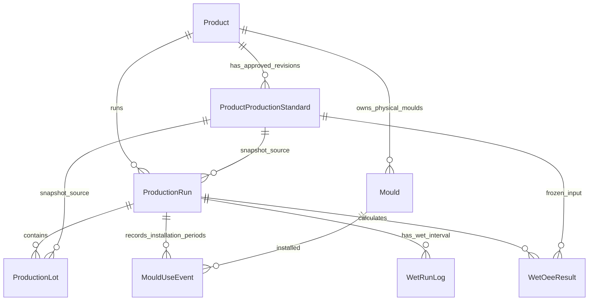

# OmagMES Product Production Standard Master — Design Proposal

**Prepared:** 2026-11-08  
**Status:** Design-only proposal for plant-owner review. No schema, database, application, source workbook, or FittingMES files were changed.  
**Related rules:** [OmagMES_Confirmed_Business_Rules.md](OmagMES_Confirmed_Business_Rules.md), [OmagMES_Database_Design.md](OmagMES_Database_Design.md), and [OmagMES_Product_Standards_and_Wet_OEE_Excel_Analysis.md](OmagMES_Product_Standards_and_Wet_OEE_Excel_Analysis.md).

## 1. Purpose and design boundary

Define a Product-owned master for the two confirmed production standards:

- `StandardPiecesPerDrop`: positive whole number of Pieces produced by one press Drop.
- `StandardCycleTimeSec`: positive decimal number of seconds per press Drop.

One press stroke is one Drop; Drop is not Piece. Both values belong to Product, not Mould. All physical Moulds assigned to a Product use that Product's standards. Do not infer either value from actual production, mould usage, pallet quantity, product code, or the other standard.

This proposal follows the verified ID-first rules in [the OmagMES database skill](../skill/DATABASE_ID_FIRST_DESIGN_SKILL.md) and [the FittingMES database skill](../../FittingMES/skill/DATABASE_ID_FIRST_DESIGN_SKILL.md): every eventual table has `id bigint IDENTITY(1,1) NOT NULL PRIMARY KEY` and `Rectime datetime NOT NULL DEFAULT (GETDATE())`; foreign keys use authoritative IDs. Those conventions are design constraints, not authorization to implement.

**Explicitly out of scope:** SQL DDL/DML, schema/migrations, application/API/UI, workbook edits, FittingMES edits, database access, commits, or pushes. The CSV and monthly reports are evidence/candidates only; this design does not approve imports or standards.

## 2. Evidence labels and conclusions

- **CONFIRMED:** owner-defined rules, including positive integer Pieces/Drop, positive decimal seconds/Drop, and Product ownership.
- **OBSERVED:** cell content or behavior found in the Jan–Oct 2026 monthly source workbooks; not an approved standard.
- **PROPOSED:** entity, constraint, snapshot, or processing recommendation for owner review.
- **UNRESOLVED:** source authority, process policy, or technical detail that must not be silently assumed.

### Excel source-cell findings

The ten monthly `Production Report (Block)*.xlsm` copies contain `Std Data`. The inspection opened each workbook read-only, with formula and saved-value views; no workbook was saved, recalculated, macro-run, or externally refreshed.

| Field candidate | Observed location | What the source establishes | What it does not establish |
|---|---|---|---|
| Product Code | `Std Data!A` | Exact code text used as the report lookup key. | Authority of the CSV or workbook as the live Product Master. |
| Product name | `Std Data!B` | Report-side English description to review against CSV `EnglishName`. | Canonical/approved Product name; CSV name and source description must not be silently substituted. |
| Standard Pieces/Drop | `Std Data!BA` | **Owner-confirmed meaning:** Pieces produced by one press Drop; Product-owned. The historical header stack still shows Thai `ก้อน/Drop` in `BA2` and `pcs./pallet` in `BA3`. | The conflicting source labels do not establish why historical rows differ or approve any numeric value. Each value still needs factory reconciliation, authoritative source, approver, and effective date. |
| Standard Cycle Time | `Std Data!BC` | `BC2` is `Cycle Time`; `BC3` is `Second`; report formulas look up column 55 (`BC`) by Product Code. **Owner-confirmed meaning:** seconds per press Drop; Product-owned. | Historical row values are not thereby approved. Workbook approval, effective date, and resolution of duplicate/cross-month numeric conflicts remain open. |

**Illustrative evidence row, not an approved seed:** exact CSV code `ZCC010010060011`, CSV name `UNI PAVE 6 CM. - GREY`; Jan and Oct `Std Data` row 8 show `BA8=45`, `BC8=26` and the same report-side name. The owner-confirmed interpretation is 45 Pieces/Drop and 26 seconds/Drop, but these historical observations are not approved standards and still require source/revision approval and effective dates.

**Derived rates:** `StandardDropsPerMinute = 60 / StandardCycleTimeSec`; `StandardDropsPerHour = 3600 / StandardCycleTimeSec`; and `StandardPiecesPerHour = StandardDropsPerHour × StandardPiecesPerDrop`. These are calculated from the two confirmed Product standards, not additional independent source values. Whether to persist or display them is a separate design decision.

### Exact-code reconciliation to the CSV

The CSV has 855 unique exact Product Codes: 118 marked `ObservedInProduction=YES` and 737 marked `NO`. In the ten `Std Data` copies, 800 exact CSV codes appear at least once; 55 CSV codes do not appear in those sheets. Of the 118 `YES` codes, 110 appear in `Std Data` and 8 do not. Each of those 110 has at least one nonblank saved BA and BC value across the monthly sheets. These are coverage observations only, not proof of completeness, correctness, or approval.

**Duplicate-aware qualification:** Some exact Product Codes occur in multiple rows of the same `Std Data` sheet, and those rows can disagree. Among CSV-matched codes, BA has same-month conflicting nonblank values for 12 codes across 98 code/month cases; BC has same-month conflicting nonblank values for 10 codes across 69 code/month cases. The full Jan–Oct scan identifies **25 exact codes** with any conflict: **13 BA** and **17 BC** (overlapping groups); 22 match the CSV exactly and 3 do not. For example, `ZCC0102A5560011` has BC values 40/35 in Jan and 41/35 in Feb; `ZCC025200000014` has BC values 150 and 30 in each inspected month. Consequently, a simple one-row-per-code monthly comparison can conceal material conflicts and is not a valid method to select one standard. BA and BC units are confirmed by the owner; the numeric values remain unresolved and unapproved. See the [complete conflict review](OmagMES_Product_Standard_Conflict_Review.md) and its source-locator [CSV](OmagMES_Product_Standard_Conflict_Review.csv).

Previous summary comparisons identified apparent cross-month BC changes such as `ZCC010163330011R` 37→36, `ZCC010415560002K` 40→41, `ZCC010582260168` 3→30, and `ZCC01021226091S` 55→60. These are observed values only; duplicate rows, missing cells, and lack of effective dates mean the precise approved change history cannot be inferred. No observed row is automatically selected as the currently approved value. Preserve exact Product Code spelling/case; do not normalize, merge, or infer missing values.

## 3. FittingMES reference: reuse and avoid

Read-only review covered FittingMES `ProductCodeMaster`, `PressProductCapability`, capability speed configuration, validation, production assignment, and PRINT OEE.

**Reusable patterns:** resolve Product by its authoritative master key; validate positive numeric values server-side; reject duplicate selections; save related changes transactionally; retain accountable change history; explicitly identify records whose required standard is missing; preserve Lot identity and source traceability.

**Do not copy:** FittingMES stores `StandardSpeed` on a Press–Product capability (`PressProductCapability`), uses `pcs/min`, permits a current capability row with no speed, and updates the current value without speed effective dating/history. Its OEE joins historical production to the current capability speed, so a later edit can alter historic OEE; its tests explicitly allow a result above 100%. OmagMES has one coupled Press + Wet Line, Product-owned standards shared by that Product's Moulds, `ActualDrops`, Wet camera good pieces, and a different confirmed formula. No Press–Product capability is needed for OmagMES Product standards.

## 4. Proposed logical data model

### 4.1 Product master

**`Product`** is one immutable internal identity with the skill-required `id` and `Rectime`. Candidate business fields:

- Exact `ProductCode`, unique under an explicitly chosen case-sensitive comparison/collation policy.
- English/Thai display names, active state, optional ProductFamily FK only if its authoritative master is approved.
- Product name/code change actor, timestamp, reason and prior value in audit/history; names are not keys.

A code spelling change must not implicitly merge Products or create an alias. Product codes from the CSV remain candidates until their authority and activation are approved. Do not auto-load all 855 records or infer Color from codes or names.

### 4.2 ProductProductionStandard revision

**`ProductProductionStandard`** is a Product-owned, effective-dated revision. Every row has the required `id` and `Rectime`, plus:

- `ProductID` FK.
- `RevisionNo` (unique within Product) and approved status/lifecycle.
- `EffectiveFrom` inclusive and `EffectiveTo` exclusive, with null end for the open-ended current/future revision if chosen by owners.
- `StandardPiecesPerDrop` positive integer.
- `StandardCycleTimeSec` positive decimal, in seconds per press Drop.
- Approval/source metadata: source reference, entered/approved actor IDs where available, approved/effective timestamps, change reason, and optional evidence note.

An approved revision must contain **both** standards; no zero, negative, or blank approved value. If a draft workflow is desired, drafts must be clearly non-effective and unusable by production/OEE. Do not place one standard on Product and the other on Mould or permit inconsistent Mould overrides.

**Versioning recommendation:** retain prior approved values; a change creates a new revision and never silently rewrites standard values already used for production. Validate `EffectiveFrom < EffectiveTo` when bounded, prevent overlapping approved periods for one Product, and ensure the production timestamp resolves to no more than one approved revision. Gaps are allowed only as an explicit state: a Run without an applicable approved standard is flagged and is not assigned an invented value. Enforce interval overlap under a serialized transaction/locking strategy or equivalent reviewed SQL Server mechanism; a row-level positive-value check alone is not sufficient. Record any boundary correction with old/new dates and actor/reason.

The decimal precision/scale, revision numbering policy, approval roles, retroactive effective dates, and whether future-dated revisions are allowed remain for owner approval. Do not inherit FittingMES `decimal(10,2)` or its two-decimal `pcs/min` rules.

### 4.3 Mould and MouldUseEvent

**`Mould`** has one required `ProductID` FK. Product 1:M physical Moulds; each Mould belongs to exactly one Product. There is no Mould/Product junction or capability table, and Color is not a Mould attribute. A Product standard change applies to the Product's Moulds; historical use remains tied to the standard snapshot applicable to the production record.

**`MouldUseEvent`** identifies a Mould installed on the one physical Press during a Run (and, where required, a Lot interval), with start/end and source/actor metadata. Validate that Mould.ProductID matches the Run/Lot Product and that simultaneous installed intervals cannot conflict. Mould changes alone do not create a new Run/Lot. Usage/counter attribution uncertainty remains explicit if the shared counter samples do not bracket a change.

## 5. Production standard snapshots and history protection

**PROPOSED:** Freeze the applied revision and its two numeric values at production boundaries; historical calculations never join to a mutable “current standard” alone.

- Store a `ProductProductionStandardID` reference and copied `StandardPiecesPerDrop` / `StandardCycleTimeSec` snapshot on the relevant Production Run and Lot (or a normalized immutable snapshot row referenced by both). Include the Product ID, revision identifier, snapshot timestamp, and source/approval provenance needed to explain selection.
- A snapshot is written when the production context is opened; later master edits do not change it. Do not update prior snapshots during a master edit, import, report refresh, or OEE recalculation.
- A Lot snapshot may reference the Run snapshot when they are identical, but it must be possible to prove which revision and values were used. A mismatch between Run and Lot Product IDs or snapshot values is rejected.
- OEE calculations use the stored snapshot or a separately immutable application record, never the latest ProductProductionStandard value. Preserve recalculation inputs, formula version, and resulting status for audit where OEE results are persisted.

**Owner decision required:** if a standard becomes effective while a Run/Lot is still open, determine whether the existing Lot remains on its original snapshot until close, a new standard-application segment is created at the effective timestamp, or another explicit boundary is required. Do not silently switch standards mid-Run/Lot, and do not create a new Run/Lot just for a standard revision without approval. Product/Color Run/Lot boundaries remain governed by the confirmed business rules.

## 6. Wet OEE source map and proposed calculation

The Wet Press and Wet Line are one coupled unit with one Wet Run Log/OEE. Dry Line/Depallet is independent and excluded from Wet OEE. Align every input to the same Run, Product-standard snapshot, and exact time window.

| Measure | Confirmed source/meaning | Proposed validation and unresolved policy |
|---|---|---|
| Actual Drops | Reset-aware accumulation of PLC/Kepware `ProductCnt`; one stroke is one Drop. | No negative deltas; retain counter reset, quality, gap, late/out-of-order and boundary uncertainty. A five-minute counter delta crossing a Run/Product boundary cannot be split proportionally without an approved method; mark uncertain/unallocated. Never use drops as good Pieces. |
| Wet Good Pieces | IP Camera `product_count` records where `line='wet'`. | Define event window, deduplication/correction, latency, Product/Run attribution, and whether late camera records revise closed OEE. Do not replace with HMI rejects or Press drops. |
| Availability | Wet Run Log. | Owners must define planned production seconds, operating seconds, and how coupled Press/Wet Line stoppages and planned time are classified. Dry downtime never enters this Wet denominator. |
| Product standard | Run/Lot frozen standard snapshot. | Required `StandardCycleTimeSec` and `StandardPiecesPerDrop` for the aligned Product interval; missing/invalid snapshot makes the affected calculation unavailable. |
| HMI Wet Rejects | Reason-classified Wet reject records; may not include all calculated losses. | Use for reject reason analysis only; not a substitute for camera Good Pieces or the Quality numerator/denominator unless separately approved. |

For one Product in one aligned segment, the confirmed proposed calculations are:

- `Performance = ActualDrops × StandardCycleTimeSec / OperatingSeconds`
- `Quality = IPCameraWetGoodPieces / (ActualDrops × StandardPiecesPerDrop)`
- `OEE = Availability × Performance × Quality`

For a reporting window with multiple Product/standard segments, aggregate compatible quantities rather than applying one Product's standard to all Drops:

- `Performance = Σ(ActualDropsᵢ × StandardCycleTimeSecᵢ) / Σ(OperatingSecondsᵢ)`
- `Quality = Σ(IPCameraWetGoodPiecesᵢ) / Σ(ActualDropsᵢ × StandardPiecesPerDropᵢ)`

Here `i` is a time-aligned Product/standard segment; do not combine unresolved mixed-Product data under one standard. Availability aggregation and the relationship between segment operating time and Run Log time require owner confirmation.

**Data-quality behavior proposed for review:** missing inputs, invalid intervals, uncertain counter attribution, and zero denominators produce `NOT_CALCULABLE`/ineligible with a reason, not a substituted zero. Zero operating seconds makes Performance undefined; zero expected pieces (no Drops) makes Quality undefined. A completed interval with no production may still have an Availability value if its Run Log is complete, but OEE eligibility is separate. Ratios above 100% are retained as calculated and flagged for review; do not silently clamp. Define whether such a result is provisional, excluded, or accepted only after source reconciliation.

## 7. Data validation, audit, and access controls

- Product is resolved through its authoritative Product ID and exact Product Code policy; no case-folding, suffix stripping, or name matching.
- Approved standard values are positive: Pieces/Drop is a whole integer; CycleTimeSec is a positive decimal in seconds/Drop.
- Approved standard revisions have both values and one unambiguous effective revision per Product/time. Unknown periods remain missing; never backfill from historical actuals.
- Product standards are immutable by revision. Corrections, effective-date changes, approval, withdrawal, and supersession preserve actor, timestamp, reason, and old/new state. Rectime is creation time only, not change or approval time.
- Run/Lot Product ID and selected standard revision/value snapshots are consistent. Historical snapshots and completed OEE inputs are never refreshed from current master values.
- Mould's one Product FK is enforced independently; Mould-use validation checks Mould Product against production Product. No many-to-many capability relation is introduced.
- Record source workbook/month/sheet/cell as evidence metadata where a value was reviewed; preserve original text/value and review outcome. Evidence provenance is not proof of approval.
- Role-based edit/approval authority and two-person approval (if required) are owner decisions; authenticated user IDs are preferred over display names.

## 8. Suggested logical relationships

This is conceptual only. If snapshot columns live directly on Run/Lot rather than a separate snapshot table, remove the corresponding snapshot entity relationship in the implementation model. No snapshot table/DDL is authorized here.

## 9. Owner decisions required before implementation

1. Confirm which source is authoritative for Product identity and approved Product names; confirm whether/when the 855-row CSV can seed Product records. Preserve exact codes.
2. Resolve the 13 BA-conflict Product Codes and approve the applicable Pieces/Drop numeric value for each, using the conflict register's exact-code and cell-level evidence. The unit/meaning is confirmed; the historical stacked labels still require source-data explanation, not reinterpretation of the confirmed future rule.
3. Resolve the 17 BC-conflict Product Codes and approve the applicable seconds/Drop numeric value for each. Review the exact conflicting values/source rows, identify authority and approver, and assign effective dates; do not assume folder-month dates are effective dates or automatically select the latest snapshot.
4. Identify Pieces/Drop and seconds/Drop source authority, approver, change workflow, retroactive/future effective-date rules, and precision/scale.
5. Choose effective-period convention, overlap enforcement strategy, behavior when no standard covers a production timestamp, and how standard changes during an open Run/Lot take effect.
6. Decide whether Run and Lot both hold snapshots or Lot references a normalized Run snapshot; identify how later Lot snapshots are represented when a standard changes during a Run.
7. Define Wet Run Log planned/operating time, event boundary and close/correction semantics; align PLC `ProductCnt`, IP Camera Wet `product_count`, Product and standard snapshots to one time grain.
8. Define zero-denominator eligibility, missing/late source handling, counter-gap/boundary uncertainty, >100% review policy, and aggregation across Product segments. Do not silently clamp or impute.
9. Confirm whether OEE results/inputs are persisted, their formula-version audit, who can approve/adjust standards, and retention/access controls.

## 10. Post-approval implementation sequence (not authorized now)

1. Reconfirm target namespace and authoritative Product/Mould/user IDs; inspect existing schema only within the approved scope.
2. Approve a migration and rollback design complying with both database skills; include ID/Rectime, exact ProductCode uniqueness, revision constraints, FK rules, and concurrency-safe effective-period checks.
3. Establish an owner-reviewed source/evidence register; resolve Product master status and `BA`/`BC` mapping without bulk-importing unsupported values.
4. Add standard validation/approval workflow and immutable revision history; test missing, overlapping, boundary, concurrent-edit, correction, and withdrawal cases.
5. Add Run/Lot snapshots and tests proving later standard revisions do not alter historical calculations.
6. Implement Wet OEE source alignment and explicit data-quality statuses only after all formula and boundary decisions are approved.
7. Run tests and owner acceptance in a non-production environment. Approval of this design is not itself deployment authorization.

No code, migration, workbook, FittingMES file, or database object was changed in preparing this design.